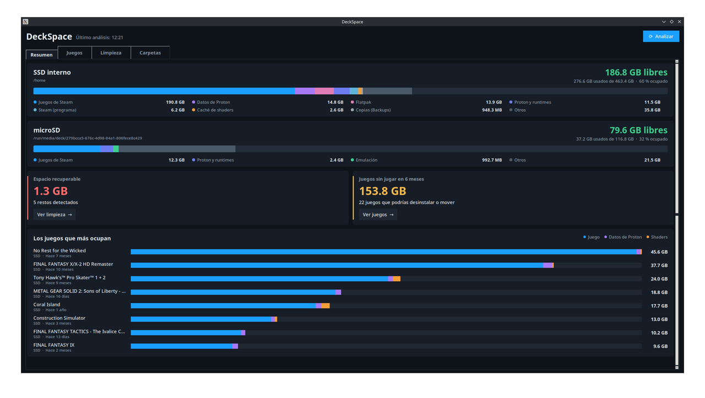
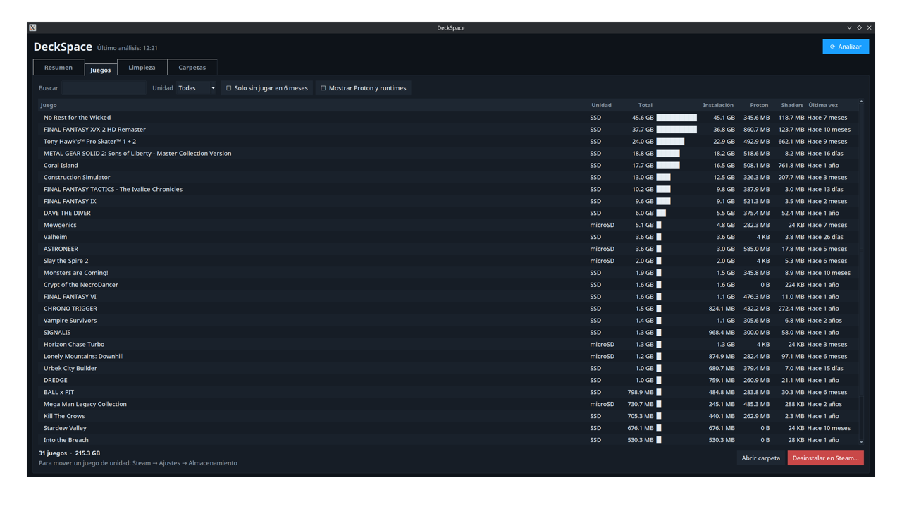
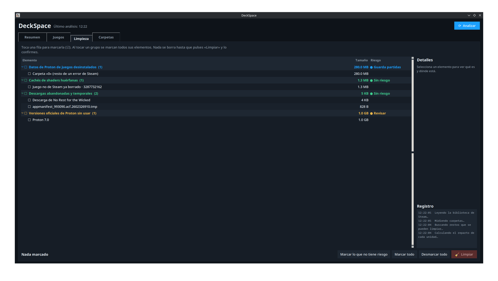

# DeckSpace

Panel de **espacio en disco** de la Steam Deck: muestra qué ocupa cada unidad (SSD y microSD),
cuánto ocupa cada juego con todo lo asociado y detecta **restos que se pueden borrar** sin riesgo.



| Juegos | Limpieza |
|---|---|
|  |  |

## Instalación
Funciona en la Steam Deck (SteamOS, modo escritorio) y en cualquier Linux con Steam.

**Requisitos**: Python 3 con Tkinter y `du` (vienen con SteamOS). No hace falta `sudo` ni tocar el sistema.

En la Deck, en modo escritorio, abre **Konsole** y escribe:
```bash
git clone https://github.com/drarekx/DeckSpace.git ~/Apps/DeckSpace
~/Apps/DeckSpace/install.sh --desktop
```
Después abre **DeckSpace** desde el menú de aplicaciones (o el icono del Escritorio).

Sin `git`, descarga el `.tar.gz` de la última versión en
[Releases](https://github.com/drarekx/DeckSpace/releases), descomprímelo en `~/Apps/DeckSpace` y ejecuta `install.sh`.

- **Actualizar**: `git -C ~/Apps/DeckSpace pull` (y cerrar y volver a abrir la app).
- **Desinstalar**: `~/Apps/DeckSpace/install.sh --uninstall` y borrar `~/Apps/DeckSpace`. La caché de nombres está
  en `~/.cache/DeckSpace` y las partidas copiadas antes de limpiar, en `~/Backups/DeckSpace`.
- `install.sh` solo crea el acceso directo `~/.local/share/applications/deckspace.desktop` (y su copia en
  `~/Desktop` con `--desktop`) apuntando a la carpeta donde está el código.
- DeckSpace nunca borra nada sin confirmación, y los juegos y las versiones oficiales de Proton los desinstala Steam.

## Uso
Abrir **DeckSpace** desde el menú (Utilidades/Sistema) o el icono del Escritorio. Analiza al abrirse.
Tema oscuro con estilo de Steam y letra y filas grandes para la pantalla táctil.
`--tab N` (0-3) abre directamente en una pestaña; sirve para hacer capturas de pantalla.

- **Resumen**: tarjetas con:
  - Una tarjeta por unidad: espacio libre, % ocupado, barra por categorías y leyenda.
  - **Espacio recuperable** y **Juegos sin jugar en 6 meses**, con botones que llevan a la
    pestaña correspondiente.
  - Los 8 juegos que más ocupan, con una barra dividida en juego, datos de Proton y shaders.
- **Juegos**: filtros por texto, por unidad, "Solo sin jugar en 6 meses" y "Mostrar Proton y
  runtimes" (botones que se marcan y desmarcan). Doble clic o "Abrir carpeta" abre la carpeta
  del juego. Para cada juego se muestra:
  - La unidad donde están.
  - El tamaño del juego, de sus datos de Proton (`compatdata`) y de su caché de shaders, y el total.
  - La última vez que se jugaron.

  Las columnas se ordenan con un clic y hay un buscador. **Desinstalar en Steam…** abre
  `steam://uninstall/<appid>`, así que es Steam quien desinstala y pide confirmación.
  Para mover un juego de unidad: Steam → Ajustes → Almacenamiento. DeckSpace no lo hace porque
  sería arriesgado.
- **Limpieza**: los restos se agrupan por tipo y tienen casillas ☐/☑. Al tocar una fila se marca;
  al tocar un grupo se marcan todos sus elementos.
  - Cada grupo indica su riesgo: verde = sin riesgo, azul = guarda partidas, amarillo = revisar.
  - El panel derecho muestra los detalles de lo seleccionado (qué es, nota y ruta) y el registro.
  - Botones: "Marcar lo que no tiene riesgo", "Marcar todo", "Desmarcar todo" y **Limpiar**.
  - **Limpiar** siempre pide confirmación en un diálogo propio, con el resumen por grupo.
- **Carpetas**: explorador del espacio de la carpeta personal y de la microSD. Al desplegar una
  carpeta se calcula su contenido con `du --max-depth=1` en segundo plano. Muestra los
  elementos de 1 MB o más (hasta 60) con su tamaño y su porcentaje sobre la carpeta. Doble clic
  abre la carpeta en el gestor de archivos. Sirve para averiguar qué hay en "Otros".

## Qué detecta como restos
| Tipo | Criterio | Riesgo / protección |
|------|----------|---------------------|
| Datos de Proton de un juego desinstalado | Carpeta `compatdata/<appid>` sin `appmanifest` ni acceso directo no de Steam con ese ID | Antes de borrar se copia `pfx/drive_c/users/steamuser` (donde suelen estar las partidas) a `~/Backups/DeckSpace/<fecha>/<appid>-<nombre>/` |
| Caché de shaders de un juego desinstalado | `shadercache/<appid>` con el mismo criterio | Ninguno: se regenera |
| Descarga abandonada | `steamapps/downloading/<appid>` cuyo juego ya está completo (`StateFlags` 4) o ya no existe | Ninguno |
| Temporales de Steam | Contenido de `steamapps/temp`, si pasa de 1 MB | Avisa si Steam está abierto |
| Manifiesto temporal sobrante | `appmanifest_*.acf.<n>.tmp` | Ninguno |
| Versión oficial de Proton sin usar | App "Proton N.0" que no es la más nueva y cuyo `proton_N` no está asignado a ningún juego instalado | La desinstala Steam (`steam://uninstall`), que pide confirmación y la vuelve a descargar si hace falta |
| Versión de Proton personalizada sin usar | Carpeta de `compatibilitytools.d` cuyo nombre interno no aparece en `CompatToolMapping` (`config/config.vdf`) para ningún juego instalado, ningún acceso no de Steam ni el valor global (`"0"`) | Se reinstala con ProtonUp-Qt. ULWGL/UMU-Proton son para lanzadores externos (umu, Heroic, Lutris): la nota lo avisa |

Los nombres de los juegos desinstalados se consultan en la API pública de la tienda de Steam
(solo se envía el appid) y se guardan en caché en `~/.cache/DeckSpace/names.json`. Sin conexión,
se muestra el ID.

## Categorías del resumen
- **Juegos de Steam**: `SizeOnDisk` de los `appmanifest`.
- **Proton y runtimes**: las apps de Steam cuyo nombre empieza por Proton, Steam Linux Runtime
  o Steamworks Common, más `compatibilitytools.d`.
- **Datos de Proton**: `compatdata`.
- **Caché de shaders**: `shadercache`.
- **Steam (programa)**: el resto de `~/.local/share/Steam` (`appcache`, runtimes, `userdata`…).
- **Flatpak**: `~/.local/share/flatpak`, `/var/lib/flatpak` y `~/.var/app`.
- **Emulación**: `<unidad>/Emulation`.
- **Copias (Backups)**: `~/Backups` y `<unidad>/SaveVault`.
- **Descargas/temporales**.
- **Otros**: lo usado menos todo lo anterior (archivos personales, `.wine`, AppImages, etc.).

Los tamaños se calculan con `du -s -B1` (bloques reales, sin seguir enlaces ni repetir
hardlinks), con 6 cálculos en paralelo. Es unas 10 veces más rápido que la v1 (unos 2 s frente a 25).

## Archivos
| Ruta | Qué es |
|------|--------|
| `deckspace.py` | Toda la app (Python estándar + Tkinter) |
| `install.sh` | Crea o quita los accesos directos |
| `README.md` | Esta documentación |
| `LICENSE` | Licencia BSD de 3 cláusulas |
| `docs/` | Capturas de pantalla |
| `NOTAS.md` | Notas privadas de esta Deck (no se sube a GitHub) |
| `~/.local/share/applications/deckspace.desktop` | Acceso directo del menú |
| `~/Desktop/deckspace.desktop` | Copia del acceso directo en el Escritorio |
| `~/.cache/DeckSpace/names.json` | Caché de nombres de juegos |
| `~/Backups/DeckSpace/` | Copias de la carpeta del usuario de los prefijos borrados |

## Arquitectura del código
- Funciones puras de análisis: `analyze(progress)` devuelve `{games, junk, drives, orphan_total}`.
  Se puede probar sin ventana: `import deckspace; deckspace.analyze(print)`.
- `clean(items, log)` ejecuta la limpieza.
- Lectura de Steam:
  - `libraryfolders.vdf`, para las bibliotecas.
  - `appmanifest_*.acf`, para los juegos.
  - `shortcuts.vdf` (binario, **solo lectura**), para los juegos no de Steam.
  - `config.vdf` (`CompatToolMapping`), para saber qué Proton usa cada juego.
- `App`: Tkinter con cuatro pestañas (`Notebook`). El trabajo pesado va en un hilo y avisa a la
  interfaz mediante una `queue`. Los eventos `("call", fn)` ejecutan código en el hilo de la interfaz.
- Estilo: `setup_style()` define el tema oscuro sobre `clam` (colores en las constantes BG,
  SURFACE…). El resumen se dibuja en un `Canvas`, colocando cada texto según el tamaño real de
  la fuente (`bottom()` y `fit()`), porque Tk escala la letra (escala 1,33 en la Deck).
- Problema conocido de Tk: al crear un `Treeview` encoge las columnas y luego solo ensancha la
  primera. `make_tree()` restaura los anchos en cada `<Configure>`.
- Los emojis de color no se ven en Tk (salen como recuadros); se usan símbolos simples (☐ ☑ ● █ →).

## Ideas pendientes
- Mover juegos entre unidades (ahora se remite a Steam).
- Flatpaks y runtimes sin usar (`flatpak uninstall --unused`).
- Integración con SaveVault: copiar las partidas antes de limpiar.
